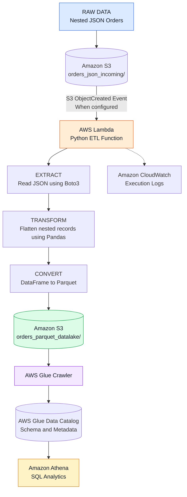

 <div align="center">


<br/>


<br/>

### Cloud Data Engineering · Serverless Computing · ETL Automation · SQL Analytics

<br/>

---

</div>

## Table of Contents

- [Project Overview](#-project-overview)
- [Business Problem](#-business-problem)
- [Solution Architecture](#-solution-architecture)
- [End-to-End Data Pipeline](#-end-to-end-data-pipeline)
- [Technology Stack](#-technology-stack)
- [ETL Processing Workflow](#-etl-processing-workflow)
- [Data Transformation](#-data-transformation)
- [AWS Services Integration](#-aws-services-integration)
- [SQL Analytics with Athena](#-sql-analytics-with-athena)
- [Repository Structure](#-repository-structure)
- [Project Screenshots](#-project-screenshots)
- [Setup and Configuration](#-setup-and-configuration)
- [Execution Workflow](#-execution-workflow)
- [Engineering Concepts](#-engineering-concepts)
- [Key Learnings](#-key-learnings)
- [Future Roadmap](#-future-roadmap)
- [Author](#-author)

---

## Project Overview

**AWS Automated Serverless ETL Pipeline** is a cloud-based data engineering project designed to transform raw nested JSON order data into structured, analytics-ready Parquet files using AWS serverless services.

The pipeline uses **Amazon S3** for data storage and **AWS Lambda** to execute Python-based ETL transformations. Nested order, customer, and product information is extracted and flattened using **Pandas and Boto3**, then converted into the columnar Parquet format.

The processed data is stored back in Amazon S3, where an **AWS Glue Crawler** discovers its schema and registers metadata in the AWS Glue Data Catalog. Finally, **Amazon Athena** enables SQL-based querying directly on the processed dataset.

The project demonstrates how multiple AWS services can work together to build a serverless data processing workflow without provisioning or managing traditional servers.

### Project Highlights

| Area | Implementation |
|---|---|
| Data Ingestion | Nested JSON files stored in Amazon S3 |
| Processing Engine | AWS Lambda with Python |
| Data Transformation | Pandas and Boto3 |
| Data Format | JSON to Apache Parquet |
| Data Storage | Amazon S3 |
| Schema Discovery | AWS Glue Crawler |
| Metadata Management | AWS Glue Data Catalog |
| Data Analytics | Amazon Athena |
| Monitoring | Amazon CloudWatch |

---

## Business Problem

Business applications frequently store order information in nested JSON structures containing customer details and multiple products.

Although JSON is useful for data exchange, nested structures are not always convenient for analytical querying.

Common challenges include:

- Nested records are difficult to analyze directly using SQL.
- Customer and product information may be embedded inside order records.
- Raw JSON is not always an efficient format for analytical workloads.
- Schema discovery and metadata management require additional processing.
- Repeated manual transformations make data processing less efficient.

**Solution:** Build an AWS-based ETL workflow that extracts nested JSON records, transforms them into structured datasets, stores them in Parquet format, and makes them accessible through SQL queries.

---

## Solution Architecture

The pipeline follows a serverless cloud architecture with separate stages for ingestion, processing, storage, metadata discovery, and analytics.

### Architecture Diagram



### Architecture Components

| Layer | AWS Service | Responsibility |
|---|---|---|
| Source Layer | Amazon S3 | Stores incoming raw JSON files |
| Processing Layer | AWS Lambda | Executes serverless ETL logic |
| Transformation Layer | Python + Pandas | Flattens nested JSON records |
| Storage Layer | Amazon S3 | Stores processed Parquet files |
| Metadata Layer | AWS Glue Crawler | Discovers dataset schema |
| Catalog Layer | AWS Glue Data Catalog | Maintains table metadata |
| Analytics Layer | Amazon Athena | Executes SQL queries |
| Monitoring Layer | Amazon CloudWatch | Captures execution logs |

---

## End-to-End Data Pipeline

The project follows an Extract, Transform, Load workflow.

```text
                  AWS DATA ENGINEERING PIPELINE

       ┌─────────────────────────────┐
       │       RAW JSON DATA         │
       │       Amazon S3             │
       └──────────────┬──────────────┘
                      │
                      ▼
       ┌─────────────────────────────┐
       │       AWS LAMBDA            │
       │       Python + Boto3        │
       └──────────────┬──────────────┘
                      │
                      ▼
       ┌─────────────────────────────┐
       │     DATA TRANSFORMATION     │
       │       Pandas DataFrame      │
       │                             │
       │  Nested JSON → Flat Records │
       └──────────────┬──────────────┘
                      │
                      ▼
       ┌─────────────────────────────┐
       │       PARQUET OUTPUT        │
       │       Amazon S3             │
       └──────────────┬──────────────┘
                      │
                      ▼
       ┌─────────────────────────────┐
       │      AWS GLUE CRAWLER       │
       │      Schema Discovery       │
       └──────────────┬──────────────┘
                      │
                      ▼
       ┌─────────────────────────────┐
       │     GLUE DATA CATALOG       │
       │     Table Metadata          │
       └──────────────┬──────────────┘
                      │
                      ▼
       ┌─────────────────────────────┐
       │       AMAZON ATHENA         │
       │        SQL QUERIES          │
       └─────────────────────────────┘

             CLOUDWATCH MONITORING
```

### Pipeline Execution Stages

| Stage | Component | Description |
|---|---|---|
| 01 | Data Ingestion | Upload nested JSON order data to Amazon S3. |
| 02 | Extraction | Read the S3 object using Boto3. |
| 03 | Transformation | Flatten nested order, customer, and product records using Pandas. |
| 04 | Conversion | Convert the transformed DataFrame into Parquet format. |
| 05 | Storage | Upload the generated Parquet file to the S3 output folder. |
| 06 | Schema Discovery | AWS Glue Crawler scans the Parquet dataset. |
| 07 | Cataloging | Glue Data Catalog stores the discovered schema and metadata. |
| 08 | Analytics | Amazon Athena queries the cataloged dataset using SQL. |
| 09 | Monitoring | CloudWatch records Lambda execution logs. |

---

## Technology Stack

### Data Engineering and Processing

| Technology | Purpose |
|---|---|
| Python | Core ETL programming language |
| Pandas | Data transformation and record flattening |
| Boto3 | AWS service integration |
| Apache Parquet | Columnar analytical storage format |

### AWS Cloud Services

| Service | Purpose |
|---|---|
| Amazon S3 | Raw and processed data storage |
| AWS Lambda | Serverless ETL execution |
| AWS Glue Crawler | Automated schema discovery |
| AWS Glue Data Catalog | Metadata and table management |
| Amazon Athena | SQL-based data analysis |
| Amazon CloudWatch | Logs and execution monitoring |

---

## ETL Processing Workflow

The core ETL logic is implemented inside `lambda_function.py`.

### 1. Extract

The Lambda function reads the S3 bucket name and object key from the incoming event.

Boto3 is used to retrieve the JSON file from Amazon S3.

```python
s3 = boto3.client('s3')

response = s3.get_object(
    Bucket=bucket_name,
    Key=file_key
)

data = json.loads(
    response['Body'].read().decode('utf-8')
)
```

### 2. Transform

The nested JSON structure is flattened into individual product-level records.

The transformation extracts:

- Order information
- Customer information
- Product information

Pandas DataFrame is used to organize the extracted information into structured columns.

### 3. Load

The transformed DataFrame is converted into Parquet format using a Parquet engine and uploaded to the S3 output folder.

```python
buffer = io.BytesIO()

df.to_parquet(
    buffer,
    index=False,
    engine='pyarrow'
)

s3.put_object(
    Bucket=bucket_name,
    Key=output_key,
    Body=buffer.getvalue()
)
```

### 4. Metadata Discovery

After generating the Parquet output, the Lambda function invokes the configured AWS Glue Crawler.

The crawler scans the output dataset and updates the Glue Data Catalog.

### 5. Analytics

Once the dataset is cataloged, Amazon Athena can access the table and execute SQL queries on the Parquet files stored in S3.

---

## Data Transformation

The source dataset contains nested order information.

The ETL process converts the nested structure into a flat, tabular dataset.

### Source Data Structure

```json
{
  "order_id": 101,
  "order_date": "2026-10-25",
  "total_amount": 2500,
  "customer": {
    "customer_id": 501,
    "customer_name": "John",
    "email": "john@example.com",
    "address": "Mumbai"
  },
  "products": [
    {
      "product_id": 1,
      "product_name": "Laptop",
      "category": "Electronics",
      "price": 2000,
      "quantity": 1
    }
  ]
}
```

### Transformed Dataset

| Column | Description |
|---|---|
| order_id | Unique order identifier |
| order_date | Date of the order |
| total_amount | Total order amount |
| customer_id | Customer identifier |
| customer_name | Customer name |
| email | Customer email |
| address | Customer address |
| product_id | Product identifier |
| product_name | Product name |
| category | Product category |
| price | Product price |
| quantity | Product quantity |

**Transformation logic:** Each product within an order is represented as an individual row, with its corresponding order and customer information.

---

## AWS Services Integration

### Amazon S3 — Data Lake Storage

Amazon S3 is used to store both raw and transformed datasets.

```text
Amazon S3 Bucket
│
├── orders_json_incoming/
│   └── orders_etl.json
│
└── orders_parquet_datalake/
    ├── orders_ETL_<timestamp>.parquet
    ├── orders_ETL_<timestamp>.parquet
    └── ...
```

### AWS Lambda — Serverless Processing

The Lambda function executes the Python ETL logic.

Responsibilities:

- Retrieve JSON files from S3.
- Extract nested order information.
- Transform records using Pandas.
- Generate Parquet files.
- Upload transformed data to S3.
- Start the configured Glue Crawler.

### AWS Glue — Schema Discovery

The Glue Crawler scans the processed Parquet location and discovers the dataset structure.

The Glue Data Catalog stores the table metadata, making the dataset available to Athena.

### Amazon Athena — Query Engine

Athena provides SQL access to the cataloged Parquet dataset without requiring a separate database server.

### Amazon CloudWatch — Monitoring

CloudWatch captures Lambda execution logs and helps inspect the processing output and errors.

---

## SQL Analytics with Athena

After the Glue Crawler creates the table, the processed dataset can be queried using standard SQL.

### Sample Query — Retrieve Records

```sql
SELECT *
FROM "AwsDataCatalog"."etl_pipeline"."orders_parquet_datalake"
LIMIT 10;
```

### Total Order Amount

```sql
SELECT
    SUM(total_amount) AS total_order_amount
FROM "AwsDataCatalog"."etl_pipeline"."orders_parquet_datalake";
```

### Product Category Analysis

```sql
SELECT
    category,
    SUM(quantity) AS total_quantity,
    SUM(price * quantity) AS total_sales
FROM "AwsDataCatalog"."etl_pipeline"."orders_parquet_datalake"
GROUP BY category
ORDER BY total_sales DESC;
```

### Customer Order Analysis

```sql
SELECT
    customer_id,
    customer_name,
    COUNT(DISTINCT order_id) AS total_orders
FROM "AwsDataCatalog"."etl_pipeline"."orders_parquet_datalake"
GROUP BY customer_id, customer_name
ORDER BY total_orders DESC;
```

*Note: Update the database and table identifiers in these examples if your Glue Catalog uses different names. The queries assume the listed columns exist in the cataloged table.*

---

## Repository Structure

```text
aws-automated-serverless-etl-pipeline/
│
├── lambda_function.py
│   └── AWS Lambda ETL implementation
│
├── requirements.txt
│   └── Python dependencies
│
├── sample_data/
│   └── orders_sample.json
│       └── Sample nested JSON input
│
├── screenshots/
│   ├── architecture.png
│   ├── s3_raw_json.png
│   ├── lambda_function_code.png
│   ├── lambda_success.png
│   ├── cloudwatch_logs.png
│   ├── s3_parquet_output.png
│   ├── glue_crawler.png
│   └── athena_query_results.png
│
├── .gitignore
│
└── README.md
```

---

## Project Screenshots

Screenshots documenting the implementation and AWS service integration.

### 01. AWS Architecture


### 02. Raw JSON Dataset in Amazon S3


### 03. AWS Lambda ETL Implementation


### 04. Lambda Execution Result


### 05. CloudWatch Execution Logs


### 06. Transformed Parquet Output in S3


### 07. AWS Glue Crawler


### 08. Amazon Athena Query Results


---

## Setup and Configuration

### Prerequisites

- AWS Account
- Python 3.x
- Git
- AWS permissions for S3, Lambda, Glue, Athena and CloudWatch
- Lambda deployment package containing Pandas and PyArrow dependencies

### Step 1 — Clone Repository

```bash
git clone https://github.com/samyakGIT-cloud/aws-automated-serverless-etl-pipeline.git

cd aws-automated-serverless-etl-pipeline
```

### Step 2 — Install Dependencies

```bash
pip install -r requirements.txt
```

### Step 3 — Configure Amazon S3

Create an S3 bucket and configure the following folders:

```text
orders_json_incoming/
orders_parquet_datalake/
```

Upload the sample JSON file to the incoming folder.

### Step 4 — Configure AWS Lambda

Create a Lambda function and deploy `lambda_function.py` with the required Python dependencies.

Configure its execution role with the required permissions:

- S3 GetObject access for incoming data.
- S3 PutObject access for processed data.
- CloudWatch logging permissions.
- Permission to start the configured Glue Crawler.

### Step 5 — Configure AWS Glue

Create a Glue Crawler and point its data source to the Parquet output folder in S3.

Configure its target database in the Glue Data Catalog.

### Step 6 — Configure S3 Event Notification

For automatic event-driven processing, configure an S3 `ObjectCreated` notification to invoke the Lambda function when a new JSON object is uploaded.

Ensure the Lambda resource-based policy allows invocation by the S3 bucket.

### Step 7 — Configure Amazon Athena

Open Athena, select the Glue Data Catalog database, and execute SQL queries against the discovered table.

---

## Execution Workflow

The pipeline can be tested using the following sequence:

```text
1. Upload JSON file to S3
          |
          ▼
2. Invoke Lambda with S3 event
          |
          ▼
3. Extract and flatten JSON records
          |
          ▼
4. Convert DataFrame to Parquet
          |
          ▼
5. Store Parquet file in S3
          |
          ▼
6. Start Glue Crawler
          |
          ▼
7. Update Glue Data Catalog
          |
          ▼
8. Execute SQL queries in Athena
          |
          ▼
9. Inspect execution logs in CloudWatch
```

---

## Engineering Concepts

### Serverless Computing

AWS Lambda executes the processing logic without requiring the management of dedicated servers.

### Event-Driven Architecture

An S3 ObjectCreated notification can trigger Lambda automatically when a new object is uploaded, once the notification is configured and verified.

### ETL Pipeline Design

The workflow separates extraction, transformation, and loading into distinct processing stages.

### Nested JSON Flattening

The transformation converts hierarchical JSON structures into a relational, tabular representation suitable for analytics.

### Columnar Data Storage

Parquet stores data in a column-oriented format, making it suitable for analytical workloads and column-based queries.

### Schema Discovery

AWS Glue Crawler identifies the schema of stored datasets and maintains metadata in the Glue Data Catalog.

### Serverless SQL Analytics

Amazon Athena queries datasets directly from S3 using SQL, without provisioning a traditional database server.

---

## Key Learnings

Through this project, I gained practical experience in:

- Building cloud-based ETL workflows using AWS.
- Working with Amazon S3 for raw and processed data storage.
- Developing Python-based serverless processing using AWS Lambda.
- Integrating AWS services through Boto3.
- Flattening nested JSON using Pandas.
- Converting structured data into Parquet format.
- Automating schema discovery using AWS Glue.
- Querying S3 datasets using Amazon Athena.
- Inspecting execution logs through Amazon CloudWatch.
- Understanding serverless and event-driven data processing architectures.

---

## Future Roadmap

The following improvements can extend the pipeline toward a more robust data engineering solution.

- [ ] Verify automatic S3-to-Lambda event triggering.
- [ ] Add data quality checks and schema validation.
- [ ] Implement duplicate detection and idempotent processing.
- [ ] Introduce date-based partitioning in Parquet output.
- [ ] Improve exception handling and retry mechanisms.
- [ ] Configure least-privilege IAM policies.
- [ ] Add pipeline execution metrics and alerting.
- [ ] Explore automated deployment and CI/CD.

---

## Author

<div align="center">

### Samyak Kamble

**Data Engineering | Python | SQL | AWS**

[](https://github.com/samyakGIT-cloud)

[LinkedIn](https://www.linkedin.com/in/samyak-kamble-972b10315/) · [Portfolio](https://samyakgit-cloud.github.io/samyak-portfolio/)

<br/>


**Built to explore cloud-based data engineering with AWS.**

</div>
